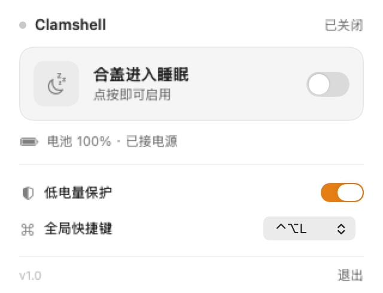
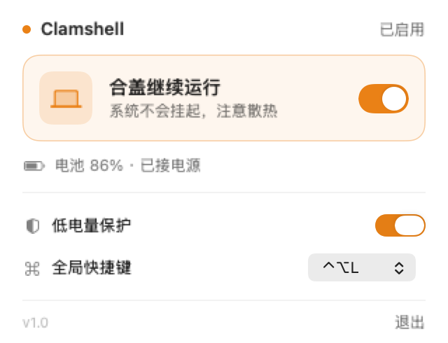
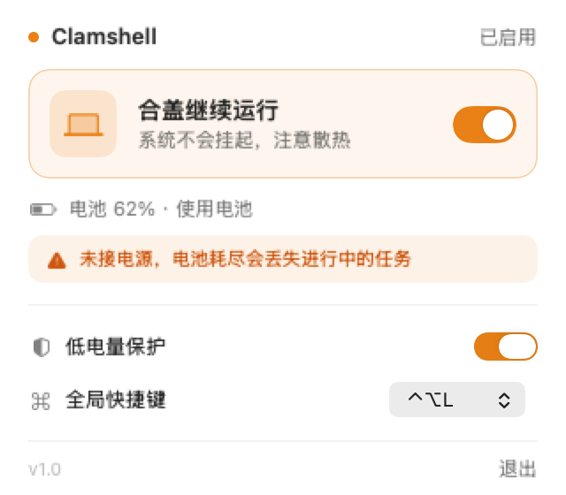

# Clamshell

一个常驻菜单栏的小工具，用来控制 macOS 的**合盖不休眠**。

点一下开始，再点一下结束。不用记命令，也不会忘了关。

---

## 它解决什么

macOS 合上盖子必定进入 clamshell sleep——这是硬件触发的事件，`caffeinate`、`pmset` 的防空闲断言全都拦不住。想让它合盖继续跑，唯一可靠的开关是：

```sh
sudo pmset -a disablesleep 1
```

问题是这条命令有两个坑：**记不住**，以及**忘了关**。忘了关的后果比忘记命令严重得多——电脑在包里持续发热，或者电池耗尽直接关机，进行中的任务一起没。

Clamshell 把它变成一个开关，并加了两个兜底。

## 功能

- **一键切换**：点主卡片即可开关，菜单栏图标同步变色（琥珀色 = 合盖仍在运行）
- **低电量保护**：低于 20% 且未接电源时自动还原，避免断电丢任务
- **未接电源提醒**：开启状态下拔掉电源，面板会直接警告
- **全局快捷键**：⌃⌥L / ⌃⌥⌘L / ⌥⌘L 三选一，或关闭
- **退出保护**：还在开启状态时退出，会先问要不要还原

## 界面

| 关闭 | 开启（接电源） |
|---|---|
|  |  |

开启状态下拔掉电源，会自动出现警告行：



菜单栏图标：白色 = 正常睡眠，琥珀色 = 合盖继续运行。

## 安装

```sh
cp -R dist/Clamshell.app /Applications/
open /Applications/Clamshell.app
```

因为是 ad-hoc 签名（没有 Apple 开发者证书），首次打开如果被 Gatekeeper 拦下，在 Finder 里**右键 → 打开**即可，只需一次。

启动后出现在菜单栏，没有 Dock 图标。

## 首次授权

第一次点开关时，会弹一次系统管理员密码框。

它做且只做一件事：写入 `/etc/sudoers.d/clamshell`，内容是

```
你的用户名 ALL=(root) NOPASSWD: /usr/bin/pmset -a disablesleep 0, /usr/bin/pmset -a disablesleep 1
```

**只授权这一条命令的两个取值**，不多给任何权限。写入后立刻用 `visudo -c` 校验语法，校验失败会自动回滚，不会弄坏你的 sudo 配置。

此后所有切换都不再弹窗。

### 撤销授权

```sh
sudo rm /etc/sudoers.d/clamshell
```

删掉即完全还原，无残留。

## 安全提醒

- **必须接电源**。合盖运行期间靠电池跑高负载，电量耗尽是真实的关机风险。
- **散热会变差**。合盖后出风口被挡住，14 寸机型长时满载会明显降频。短时任务没问题，几小时以上的重负载建议放桌面别合盖。
- 这个开关是**全局持久**的，重启后依然生效。App 每次启动都会读回真实状态，不会骗你——但如果你用命令行改过，App 也会如实反映。

## 开发

```sh
./build.sh            # 编译 + 组装 .app + ad-hoc 签名，产物在 dist/
./Tools/make_icon.sh  # 重新生成图标（程序化绘制，无外部素材）
```

自检与调试：

```sh
dist/Clamshell.app/Contents/MacOS/Clamshell --diagnose      # 状态读取 / 电池 / 授权探测
dist/Clamshell.app/Contents/MacOS/Clamshell --toggle-test   # 走一遍真实切换并还原
dist/Clamshell.app/Contents/MacOS/Clamshell --snapshot      # 渲染三态面板图到 /tmp
dist/Clamshell.app/Contents/MacOS/Clamshell --show-panel    # 启动后直接弹出面板
```

**为什么还要一套标记文件触发**：`open -a App.app --args ...` 在 macOS 26 上不保证把参数传给已注册的 App，而从终端直接跑二进制又会被外层沙箱拦住 `sudo`。只有 LaunchServices 启动的进程才和用户双击完全等价。所以在 bundle 的 `Resources/` 里放标记文件即可触发同一套自检：

```sh
touch Clamshell.app/Contents/Resources/.toggle-test   # 启动即跑真实切换测试，结果写 /tmp/clamshell-diagnose.log
touch Clamshell.app/Contents/Resources/.selftest      # 只跑只读自检
touch Clamshell.app/Contents/Resources/.show-panel    # 启动即弹出面板
```

正式安装的 bundle 里不含这些文件，行为不受影响。

### 技术取舍

**为什么不用特权 helper（SMAppService + XPC）**

那是苹果推荐的现代方案，但它要求主 App 和 helper 都有有效的签名身份。本项目在没有 Developer ID 的情况下用 ad-hoc 签名，SMAppService 的注册不可靠。sudoers 方案零签名依赖、内容可审计、一行可删，对这个体量的工具是更合适的交换。

**为什么权限探测不用 `sudo -n -l <cmd>` 的退出码**

管理员账户自带 `(ALL) ALL`，即使没有免密规则，该命令也会返回 0。必须检查输出里是否同时出现 `NOPASSWD` 和 `disablesleep`。更稳的做法是干脆不探测——直接尝试切换，被拒再引导授权。

**为什么开启态用琥珀色而不是绿色**

"合盖还在运行"本质是一个需要注意的状态，不是"一切正常"。绿色会给错误的安心感。

## 结构

```
Sources/Clamshell/
  main.swift            进程入口
  AppDelegate.swift     菜单栏图标 + popover
  AppModel.swift        状态中心与业务逻辑
  PowerService.swift    pmset 读写
  BatteryService.swift  IOKit 电源采样
  SudoersService.swift  免密规则的安装与探测
  HotKeyManager.swift   Carbon 全局热键
  Views/PanelView.swift 面板界面
```

---

<sub>Clamshell 1.0 · 为 macOS 13+ 构建，在 macOS 26 / M2 Max 上验证 · MIT License</sub>
